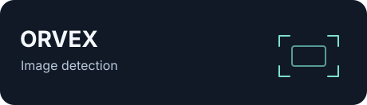

**Chungju, South Korea** &nbsp;|&nbsp; [Repositories](https://github.com/waheddevs?tab=repositories)

## About

I'm a Senior Full Stack, DevOps, and AI Engineer with four years of professional software engineering experience. I build scalable web applications and cloud-native infrastructure, covering frontend and backend development, system architecture, CI/CD automation, and production deployment.

I also work with machine learning, deep learning, computer vision, and LLM integration to build AI features. My projects include education dashboards, travel booking workflows, and tools for analyzing images.

## Tech Stack

**Frontend**

TypeScript, React, Next.js, Sass

**Backend & Data**

Node.js, NestJS, GraphQL, PostgreSQL

**AI & Computer Vision**

Python, OpenCV, PyTorch, FastAPI

**Cloud & DevOps**

AWS, Docker, Linux, Git

## Featured Projects

  
  

- **Cavora**: Tour reservations, Stripe payments, and admin workflows. [Frontend](https://github.com/waheddevs/cavora-react) / [Backend](https://github.com/waheddevs/cavora-server)
- **ORVEX**: Object detection with saved results and PNG or JSON exports. [Frontend](https://github.com/waheddevs/orvex-client) / [API](https://github.com/waheddevs/orvex-server)
- **Best LC**: Multilingual education platform with student, teacher, and admin dashboards for assessments, schedules, and progress tracking.

## Work Experience

**Techhero** / Full Stack Software Engineer  
*Apr 2025 - Aug 2026*  
Built role-specific dashboards and integrated GraphQL APIs for Best LC.

**AiNex, South Korea** / Full Stack Software Engineer  
*Feb 2024 - Dec 2025*  
Developed web interfaces for a corporate site and an online learning platform.

**Nexus** / Frontend Mobile and Web Developer  
*Mar 2022 - Feb 2023*  
Built responsive screens and reusable components, and integrated REST APIs.
