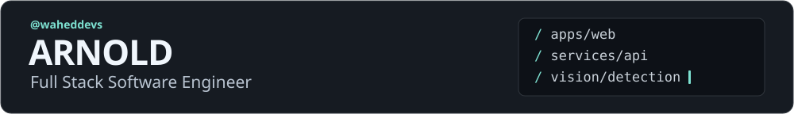

<strong>Chungju, South Korea</strong> � <a href="https://github.com/waheddevs?tab=repositories">Explore repositories</a>

## About Me

I'm a full stack software engineer based in Chungju, South Korea. I build web applications, from education dashboards and booking workflows to computer vision tools that turn image uploads into visible detection results.

## Tech Stack

| Area | Tools |
| :--- | :--- |
| Frontend |    TypeScript � React � Next.js � Sass |
| Backend & Data |    Node.js � NestJS � GraphQL � PostgreSQL |
| AI & Computer Vision |    Python � OpenCV � PyTorch � FastAPI |
| Cloud & DevOps |    AWS � Docker � Linux � Git |

## Featured Projects

| Cavora | ORVEX |
| :--- | :--- |
|  |  |
| Travel booking app with reservations, Stripe payments and admin workflows. | Image detection workspace with saved analysis history and PNG/JSON exports. |
| [Frontend](https://github.com/waheddevs/cavora-react) � [Backend](https://github.com/waheddevs/cavora-server) | [Frontend](https://github.com/waheddevs/orvex-client) � [API](https://github.com/waheddevs/orvex-server) |

**Best LC** � Multilingual education platform with student, teacher and admin dashboards for assessments, class schedules and progress tracking.

## Work Experience

**Techhero � Full Stack Software Engineer**  
Apr 2025 - Aug 2026  
Built role-specific dashboards and integrated GraphQL APIs for a multilingual education platform.

**AiNex, South Korea � Full Stack Software Engineer**  
Feb 2024 - Dec 2025  
Developed web interfaces for a corporate site and contributed to an online learning platform.

**Nexus � Front-end Mobile and Web Developer**  
Mar 2022 - Feb 2023  
Built responsive screens and reusable UI components, and integrated REST APIs.
